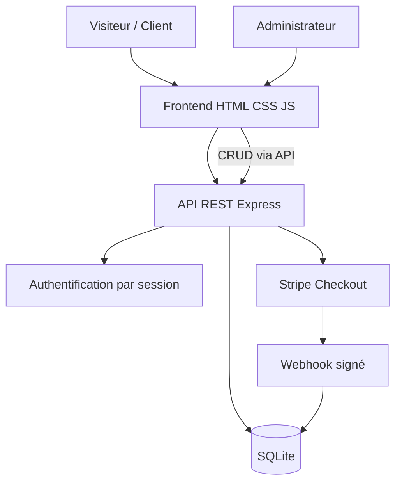
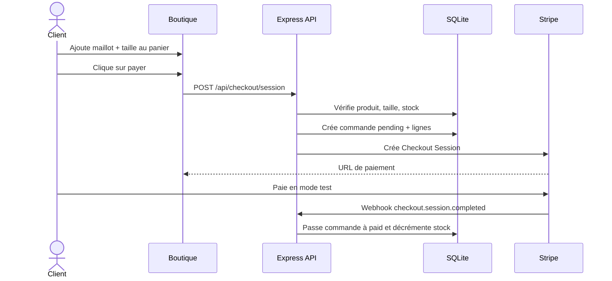
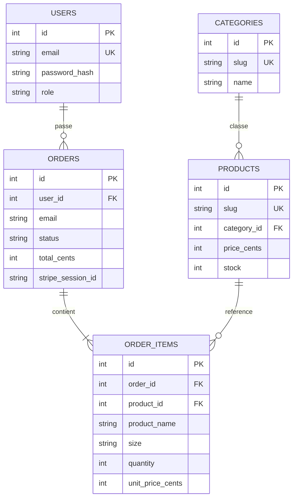

# Architecture technique — TERRAIN

## 1. Vue d'ensemble

## 2. Cycle de commande

## 3. Modèle relationnel

## 4. Pages de la boutique

- `#home` : accueil, catégories, sélection mise en avant.
- `#shop` : catalogue, filtres, recherche.
- `#product/:slug` : fiche produit et choix de taille.
- `#cart` : panier et redirection Stripe.
- `#account` : inscription, connexion, commandes.
- `#admin` : back-office (visible pour un compte admin).

La page admin est un espace protégé, pas une page publique de vente.
