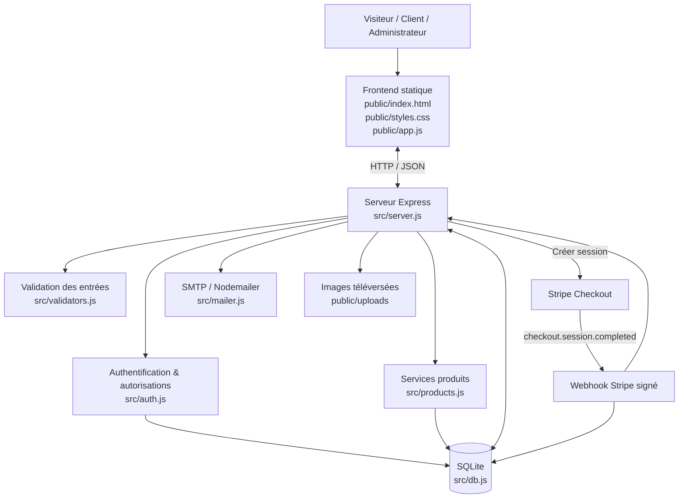
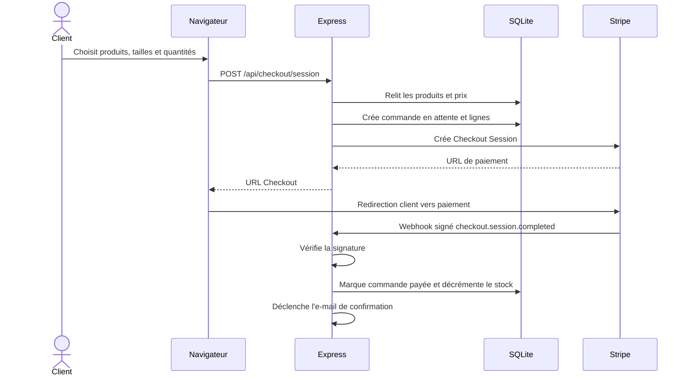
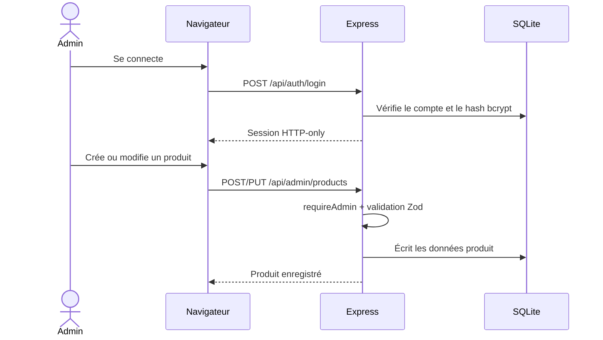

# Architecture technique — TERRAIN

## 1. Vue logique

## 2. Organisation du code

| Chemin | Responsabilité |
|---|---|
| `public/` | Interface client, styles, JavaScript navigateur et fichiers statiques |
| `src/server.js` | Initialisation Express, middleware, routes REST, Stripe et logique de commande |
| `src/config.js` | Lecture et validation des variables d'environnement |
| `src/db.js` | Ouverture SQLite, création des tables et migrations simples |
| `src/auth.js` | Création des comptes, vérification des mots de passe et gardes d'accès |
| `src/products.js` | Requêtes et transformations des produits |
| `src/validators.js` | Schémas Zod pour inscription, connexion, produits et checkout |
| `src/mailer.js` | Envoi des e-mails de commande et d'expédition |
| `src/seed.js`, `scripts/seed.js` | Initialisation des données / compte administrateur |
| `tests/` | Tests automatisés |

## 3. Séquence de paiement

Le webhook est déclaré avant le middleware JSON afin de recevoir le corps brut requis pour la vérification de signature Stripe.

## 4. Séquence d'administration

## 5. Pages applicatives

- `#home` : accueil et sélections.
- `#shop` : catalogue, recherche et filtres.
- `#product/:slug` : fiche produit.
- `#cart` : panier et redirection vers Stripe Checkout.
- `#account` : inscription, connexion et commandes.
- `#admin` : interface d'administration protégée par le rôle `admin`.

## 6. Limites techniques connues dans cette version

- Le checkout demande l'e-mail client et les lignes de panier ; aucune adresse postale de livraison n'est collectée.
- Les sessions utilisent le store mémoire par défaut d'Express.
- Le stock est décrémenté lors de la réception du webhook de paiement ; la gestion de concurrence et de réservation préalable doit être renforcée pour une exploitation réelle.
- Le filtre d'upload accepte les types MIME JPEG, PNG, WEBP et GIF et limite la taille à 5 Mo, mais ne vérifie pas le contenu binaire réel du fichier.
- Les e-mails envoyés sont une confirmation de commande et une notification d'expédition ; aucune facture PDF n'est construite ni jointe par le module SMTP.
