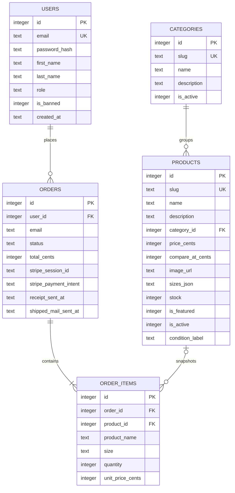

# Modèle de données — TERRAIN

La base est SQLite. Elle est initialisée dans `src/db.js`. Le fichier utilisé par défaut est `./data/store.db` (modifiable avec `DATABASE_FILE`).

## Diagramme relationnel

## Tables

| Table | Rôle |
|---|---|
| `users` | Comptes clients et administrateurs, hash de mot de passe, rôle et statut de bannissement |
| `categories` | Catégories du catalogue et activation |
| `products` | Fiches produits, prix en centimes, tailles JSON, stock, image et état |
| `orders` | Commandes, statut, total et identifiants Stripe |
| `order_items` | Lignes de commande avec copie du nom et du prix au moment de l'achat |
| `sessions` | Table de sessions présente dans le schéma ; le serveur Express courant utilise toutefois son store par défaut, pas ce stockage SQLite |
| `seed_state` | Marqueurs utilisés par l'initialisation de données |

## Conventions

- Les montants sont stockés en centimes (`price_cents`, `total_cents`, `unit_price_cents`).
- Les tailles d'un produit sont stockées dans `sizes_json`.
- Les mots de passe sont stockés sous forme de hash bcrypt, jamais en clair.
- Les produits et catégories peuvent être archivés via leurs champs `is_active`.
- Les lignes de commande conservent le nom du produit et le prix unitaire afin de préserver l'information de vente.

## Index

Le schéma crée notamment des index pour le catalogue par catégorie/état, l'historique des commandes par client, les lignes de commande et l'expiration des sessions.
